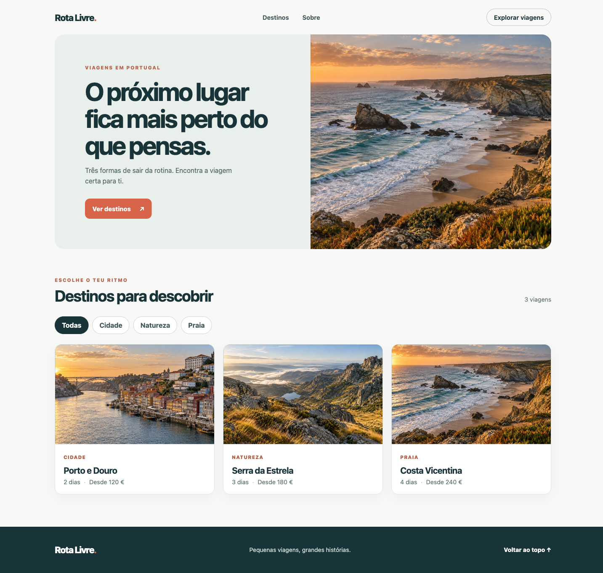

# Prova final — Rota Livre

**Duração:** 3 horas · **Trabalho:** individual · **Tecnologia:** React e JavaScript

## Missão

Constrói, de raiz, uma aplicação React que reproduza a página de viagens apresentada na [imagem de referência](referencia.png). A aparência não tem de ser idêntica ao píxel; a página deve conservar o conteúdo, a organização visual e o comportamento descrito abaixo.



## Materiais fornecidos

- [modelo.html](modelo.html): página estática que podes abrir no browser para consultar a estrutura e as classes. Os filtros **não funcionam** neste ficheiro;
- [App.css](App.css) e [index.css](index.css): estilos prontos a utilizar;
- [viagens.js](viagens.js): dados das viagens;
- pasta [imagens/](imagens/): fotografias usadas na página;
- `referencia.png`: aspeto inicial esperado.

O `modelo.html` é uma referência HTML, **não é uma aplicação React** nem um ficheiro para entregar como resultado final. Não recebes um projeto React iniciado nem código da interação. Não precisas de escrever CSS.

## O que a aplicação deve fazer

1. Apresentar a landing page com navegação, destaque, catálogo de viagens e rodapé, utilizando os estilos e imagens fornecidos.
2. Apresentar os destinos a partir dos dados de `viagens.js`. Alterar um destino nesse ficheiro deve refletir-se no conteúdo mostrado, sem ser necessário reescrever o cartão à mão.
3. Ao abrir a aplicação, mostrar as três viagens e indicar **«3 viagens»**. A opção **«Todas»** deve aparecer ativa.
4. Ao escolher **«Cidade»**, **«Natureza»** ou **«Praia»**, mostrar apenas as viagens desse tipo. O botão escolhido deve ficar visualmente ativo e a contagem deve acompanhar os resultados — por exemplo, **«1 viagem»**.
5. Ao voltar a **«Todas»**, mostrar novamente as três viagens. A interação deve acontecer sem recarregar a página.
6. Os links de navegação devem levar às secções correspondentes da página.

Organiza o código em componentes React com responsabilidades compreensíveis. A apresentação dos dados e a interação devem ser controladas pelo React, sem manipulação direta do DOM. **Tu decides** quantos componentes criar, que dados passam entre eles e como representar a escolha do utilizador.

Não são pedidos reserva de viagens, formulário, pesquisa, API, persistência após atualizar a página nem CSS adicional.

## Preparação e entrega

Cria um projeto React com Vite e instala as dependências:

```bash
npm create vite@latest viagens-react -- --template react
cd viagens-react
npm install
npm run dev
```

Usa os ficheiros fornecidos no projeto: os CSS em `src/`, `viagens.js` em `src/data/` e as fotografias em `public/imagens/`. O `modelo.html` pode ser aberto separadamente para consulta; **não substitui** o `index.html` do Vite. Se o Vite já criou ficheiros CSS com os mesmos nomes, substitui o conteúdo pelos estilos fornecidos.

Antes de entregar, verifica as quatro opções de filtro, a contagem, o botão ativo, as imagens e os links. Executa `npm run build` e corrige os erros. Entrega a pasta do teu projeto sem `node_modules/` e sem `dist/`.

Na demonstração final, explica brevemente como organizaste os componentes, de onde vêm os dados e o que acontece na interface quando se escolhe uma categoria. A avaliação considera a estrutura, os dados, o funcionamento, a verificação e a explicação — não a escrita de CSS nem uma divisão obrigatória em componentes específicos.
